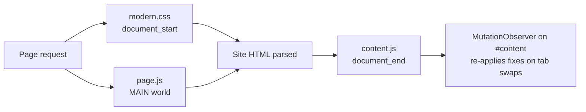

# MySELF JPA Modern


A Chrome extension that gives [myself.jpa.gov.my](https://myself.jpa.gov.my) a modern, cleaner, mobile-friendly look, without changing how the site works.

**Jump to:** [Install](#-install) · [What changes](#-what-changes) · [How it works](#-how-it-works) · [Development](#-development) · [Pages covered](#-pages-covered)

---

## 🚀 Install

<details open>
<summary><b>Load it in Chrome (developer mode)</b></summary>

1. Clone or download this repo:
   ```sh
   git clone https://github.com/ammarnazmi/jpa-webdesign-chrome-extention.git
   ```
2. Open `chrome://extensions`.
3. Turn on **Developer mode** (top right).
4. Click **Load unpacked** and pick the repo folder.
5. Open [myself.jpa.gov.my](https://myself.jpa.gov.my). The new design applies automatically.

</details>

<details>
<summary><b>Updating</b></summary>

`git pull`, then press the ↻ reload icon on the extension card in `chrome://extensions` and refresh the site.

</details>

<details>
<summary><b>Other browsers</b></summary>

Any Chromium browser that supports Manifest V3 (Edge, Brave, Arc, Opera) loads it the same way through its own extensions page.

</details>

---

## ✨ What changes

<details>
<summary><b>Layout & look</b></summary>

- Replaces the fixed 960px 2009-era layout with a fluid, card-based one.
- Swaps clip-art GIF icons and image headings for text, badges and outline icons.
- Restyles forms, buttons, dropdowns, tables, the header and the footer.
- Restores keyboard focus outlines that the site's reset removed.

</details>

<details>
<summary><b>Mobile</b></summary>

The site has no viewport tag, so phones render it at ~980px and zoom out. The extension adds one, so the phone layout actually applies.

</details>

<details>
<summary><b>Usability fixes</b></summary>

- Login buttons move into the sign-in card (the form submits exactly as before).
- The re-registration `alert()` that shows on every visit is suppressed; validation alerts still appear.
- Modalbox pop-ups open instantly (its ~0.8s animation is turned off).
- Slow tabs (e.g. *Semak Bil Tuntutan Bulanan*, ~8s) show a loading state instead of looking frozen.
- The side menu highlights the open section.
- Status columns become coloured pills (green = lulus/sah, amber = proses, red = tidak lulus/gagal).
- Exam grades become pills: ≥ 3.00 green, below red.
- Help forms get placeholder hints.

</details>

<details>
<summary><b>Accessibility</b></summary>

- Wrong-password message is marked `role="alert"` so screen readers announce it.
- Low-contrast text (e.g. the #999 date lines) is darkened.
- The active menu item gets `aria-current="page"`; loading cards get `aria-busy`.

</details>

---

## 🧩 How it works

No build step, no dependencies. Three files are injected on `*://myself.jpa.gov.my/*`:

| File | Runs | World | Job |
|------|------|-------|-----|
| [`modern.css`](modern.css) | `document_start`, all frames | – | All visual styling |
| [`page.js`](page.js) | `document_start` | `MAIN` (page's own JS) | Wraps `window.alert`, disables Modalbox transitions |
| [`content.js`](content.js) | `document_end` | isolated | Small DOM fixes: moves elements, adds the viewport tag, status/grade pills, menu state, loading state |



<details>
<summary><b>Why <code>page.js</code> runs in the MAIN world</b></summary>

Content scripts normally run in an isolated world and can't touch the site's globals. `window.alert` and `window.Modalbox` belong to the page, so `page.js` must run in the page's own world, before the site's scripts.

</details>

<details>
<summary><b>Why a MutationObserver</b></summary>

Pages like `kutipan.php` and `bantuan.php` swap sections into `#content` via AJAX. The observer re-applies placeholders, status pills and grade pills each time, and hides the site's "Loading..." flash by keeping the previous section on screen until the new one arrives.

</details>

---

## 🛠 Development

1. Edit `modern.css`, `content.js` or `page.js`.
2. Reload the extension in `chrome://extensions`.
3. Refresh the site.

**Conventions**

- Scope CSS to the page's own elements (e.g. `body.cms-home`, `#frmBantuan`) so a rule doesn't leak to other pages.
- Prefer CSS over JS. Use `content.js` only when the DOM has to move or be marked.
- Prefix classes the extension adds with `ext-` (e.g. `ext-status`, `ext-grade`, `ext-details`).
- Comment the *why*: what the site does wrong and why the override is needed.

<details>
<summary><b>Adding a slow tab to the loading indicator</b></summary>

Add its file name to `SLOW_TABS` in [`content.js`](content.js):

```js
const SLOW_TABS = ['kutipan_semakBilTuntutan.php', 'kutipan_tukarModelPBUTamatPengajian.php'];
```

</details>

---

## 📄 Pages covered

- [x] Login (`index`, wrong-password message, announcements)
- [x] Daftar eSILA-ID info pop-up and registration form
- [x] Help (`bantuan.php`) and its sub-pages
- [x] Home after login (`home.php`): profile photo, announcements, Aktiviti MySELF
- [x] Maklumat Peribadi (`peribadi.php`)
- [x] Maklumat Perkhidmatan (`perkhidmatan.php`)
- [x] Maklumat Pelajar / Pengajian, exam slip, Kemas Kini Pelan Pengajian
- [x] Maklumat Tajaan
- [x] Bayaran Balik (`bayaran.php`, `kutipan.php`)
- [x] Mobile layout

Found a page that still looks old? [Open an issue](https://github.com/ammarnazmi/jpa-webdesign-chrome-extention/issues/new) with the URL and a screenshot.

---

<sub>Unofficial. Not affiliated with Jabatan Perkhidmatan Awam (JPA). Changes only how pages look in your own browser; no data is collected or sent anywhere.</sub>
